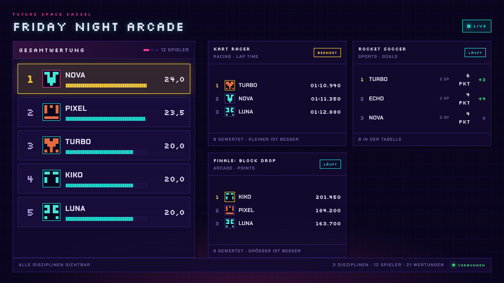
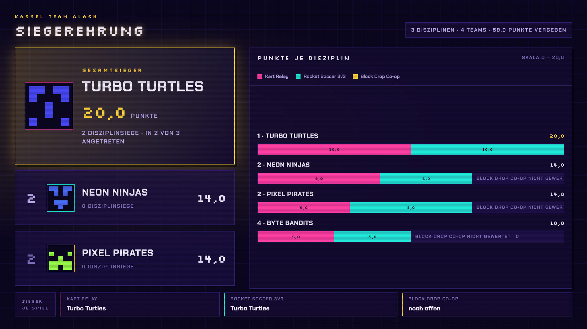
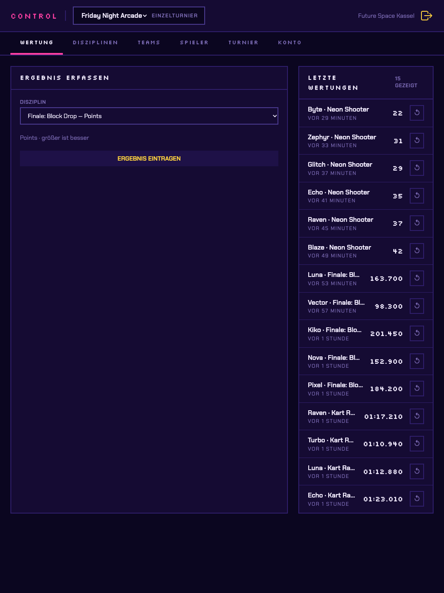

# Pixelboard — Scoreboard für Future Space Kassel

Live-Scoreboard für Gaming-Turniere und Workshops. Eingabe und Anzeige laufen
auf getrennten Geräten: auf einem Tablet werden Ergebnisse eingetragen, auf der
Leinwand erscheint das Board ohne manuellen Refresh.



Der Aufbau folgt dem STAR-Prinzip: Ausgangslage, Aufgabe, Umsetzung, Ergebnis.
Wer am Code arbeiten will, springt direkt zu [Entwicklung](#entwicklung).

---

## Situation

Future Space Kassel ist ein Social Club, der regelmäßig Gaming-bezogene
Bildungsveranstaltungen anbietet: Turniere, Workshops und Eventabende, vor
allem für Kinder und Jugendliche. Bei solchen Events laufen mehrere Disziplinen
parallel, etwa ein Rennspiel auf Zeit, ein Sportspiel im Direktduell und ein
Arcade-Spiel auf Punkte.

Bisher gab es keine gemeinsame, sichtbare Wertung. Ergebnisse auf Papier oder in
einer Tabelle sieht das Publikum nicht, und Rundenzeiten, Tore und Punkte lassen
sich nicht einfach zu einem Gesamtsieger zusammenrechnen.

## Task

Gebraucht wurde ein Scoreboard, das an einem Eventabend im Kino auf der großen
Leinwand vor vielen Kindern funktioniert und danach für die laufenden Workshops
und Events weiterverwendet werden kann. Die Anforderungen:

- **Getrennte Geräte.** Eingetragen wird auf einem Tablet, die Leinwand zeigt
  ausschließlich das Board. Dazwischen darf kein manueller Refresh liegen.
- **Faire Gesamtwertung** über Disziplinen mit völlig unterschiedlichen
  Messgrößen, inklusive Gleichständen.
- **Für Kinder lesbar** auf große Entfernung, und so gestaltet, dass jedes
  Ergebnis ein kleiner Moment auf der Leinwand ist.
- **Eine Siegerehrung**, die sich live moderieren lässt.
- **Wiederverwendbar:** Einzel- und Teamturniere, beliebige Spiele, mehrere
  Veranstalter mit eigenem Konto.
- Bedienbar von Betreuer\*innen, die nebenbei noch ein Event leiten.

## Action

### Was gebaut wurde

**Leinwand (`/board/:userSlug/:slug`)**

- Gesamtwertung mit Balken plus Karten für jede angeheftete Disziplin, ohne
  ein einziges Bedienelement. Der Rechner an der Leinwand wird einmal geöffnet
  und dann nicht mehr angefasst.
- Live-Updates über Socket.IO; zusätzlich ein 30-Sekunden-Polling als
  Sicherheitsnetz und eine Verbindungsanzeige in der Ecke.
- Toasts bei Ereignissen: erster Score, persönliche Bestleistung, neue
  Führung, Überholmanöver, aufgelöster Gleichstand, Disziplin beendet. Die
  Sprüche liegen kuratiert in `server/src/content/announcements.de.json` und
  lassen sich vor jedem Event ohne Deploy ans Publikum anpassen.
- Countdown für laufende Disziplinen.
- Auflösungsunabhängiges Layout: alle Maße hängen an einer Canvas-Einheit,
  weil die Leinwand vorher nicht bekannt war.

**Siegerehrung (`/result/:userSlug/:slug`)**



- Schrittweise Enthüllung vom letzten bis zum ersten Platz, gesteuert mit der
  Leertaste. Damit kann die Moderation die Spannung selbst dosieren.
- Danach: Gesamtsieger, Punkte je Disziplin als gestapelte Balken, Sieger je
  Spiel.

**Control-Panel (`/control`)**



- Ergebnisse eintragen und zurücknehmen, mit Liste der letzten Wertungen.
- Disziplinen anlegen, starten, beenden und aufs Board heften.
- Spieler und Teams pflegen, mit Avatar- und Banner-Upload. Wer nichts
  hochlädt, bekommt einen aus dem Namen erzeugten Pixel-Avatar.
- Spielerkarten mit Medaillenspiegel je Turnier.
- Mehrere Turniere je Konto, umschaltbar in der Kopfzeile.

**Wertung**

- Zwei Spielformen: **Metrik** (Zeit, Punkte, Frags …, jeweils „kleiner“ oder
  „größer ist besser“) und **Versus** (Direktduelle mit Tabelle: 3 Punkte für
  einen Sieg, 1 für ein Unentschieden, danach Tordifferenz und erzielte Tore).
- In die Gesamtwertung zählt nur die **Platzierung**, nie der Rohwert. So sind
  Millisekunden und Tore ohne Umrechnung vergleichbar.
- Bei geteiltem Rang werden die Punkte der belegten Plätze gemittelt. Die
  ausgeschüttete Punktsumme bleibt konstant, egal wie viele Gleichstände es
  gibt.
- Gewichtung je Disziplin (z. B. ein doppelt zählendes Finale) und eine eigene
  Punktetabelle je Turnier oder Spiel.
- Gleichstand in der Gesamtwertung: olympische Zählweise (mehr erste Plätze,
  dann zweite …).
- Einzel- oder Teamturnier. Im Teammodus wird entweder das Team gewertet oder
  jeder Spieler einzeln, und die Platzierungspunkte der Mitglieder werden fürs
  Team addiert.

**Konten**

- Registrierung mit E-Mail-Bestätigung, Passwort zurücksetzen, Konto löschen.
- Jeder Veranstalter sieht nur seine eigenen Turniere, Spieler und Teams.
  Board und Siegerehrung sind öffentlich, alles andere liegt hinter der
  Anmeldung.

### Technische Entscheidungen

- **REST schreibt, der Socket verteilt.** Nach jedem Score berechnet der
  Server den kompletten Board-Zustand neu und schickt ihn ganz, nicht als
  Delta. Ein Board, das kurz offline war, ist mit dem nächsten Ereignis wieder
  korrekt.
- **Wertungslogik testgetrieben und ohne Datenbank.** `rank`, `points`,
  `standings`, `table` und `announce` arbeiten auf einfachen Objekten; die
  Tests entstanden vor der Implementierung.
- **Ein geteilter Vertrag.** Zod-Schemas in `shared/` gelten für Client und
  Server gleichermaßen.
- **Ein Container.** Derselbe Express liefert API, Socket und das gebaute
  Frontend aus. Betrieben wird er auf einem eigenen Server per Docker,
  öffentlich erreichbar über einen Cloudflare Tunnel unter
  [pixelboard.dev](https://pixelboard.dev).

## Result

- Das Board lief beim Eventabend im Kino live auf der großen Leinwand. Viele
  Kinder konnten dort ihre Platzierungen und Überholmanöver in Echtzeit
  verfolgen, während die Ergebnisse am Rand auf dem Tablet eingetragen wurden.
- Die getrennte Eingabe hat sich bewährt: Die Leinwand musste während des
  Abends nicht angefasst werden.
- Aus dem Einzelevent ist ein wiederverwendbares Werkzeug geworden. Future
  Space setzt es künftig vor allem in Workshops und eigenen Events ein, mit
  eigenen Turnieren, Spielen und Teams pro Veranstaltung.

---

## Entwicklung

### Für den Einstieg

Drei Dateien, in dieser Reihenfolge — sie sind die Wahrheit, nicht der Code:

| Datei             | Inhalt                                                          |
| ----------------- | --------------------------------------------------------------- |
| `PROJEKT.md`      | Datenmodell, Wertungslogik, Socket-Architektur, **Stand (§12)** |
| `KONVENTIONEN.md` | Code-Standards, Ableitungsregeln, Testkonventionen              |
| `SESSIONS.md`     | Kurzlog: was gebaut, was entschieden, was offen                 |

Was als Nächstes ansteht, steht in `PROJEKT.md` §12.

### Befehle

```bash
npm install && npm --prefix server install

npm run dev              # Client (Vite)
npm run dev:server       # API mit --watch
npm run test:server      # node --test über alle *.check.ts
npm run typecheck:server
npm run lint
npm run build

npm --prefix server run seed -- --yes   # leert die DB, legt ein Beispielturnier an
```

Das `--yes` beim Seed ist Absicht: `MONGODB_URI` zeigt auf einen gehosteten
Cluster, und das Skript leert alle Collections der Datenbank `leaderboard`.

### Aufbau

```
shared/     Zod-Vertrag und Formatter, von Client und Server geteilt
server/     Express 5, Mongoose, Socket.IO, Wertungslogik in services/
src/        React 19, Vite, Tailwind v4, React Query
public/     unverändert ausgelieferte Dateien (Favicon)
docs/       Architekturdiagramm, Screenshots
```

Konfiguration über `server/.env` (Vorlage: `server/.env.example`).
